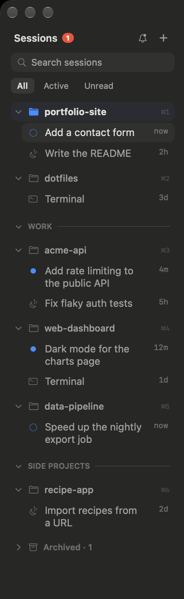

# cmux Sessions sidebar

A sidebar for [cmux](https://cmux.com) that lists your projects and the agent sessions in each one, like the session list in the Codex and Claude desktop apps. Read this to install it, or before you change the code.



## What it shows

Each project is a cmux workspace, and each session is a tab in it. The open project has a blue folder and a bold name, and the open session is highlighted. Next to each project is its ⌘1–9 shortcut, numbered the same way cmux numbers them.

Each session shows its title, how long ago it was last active and an icon for its state:

| Icon | Meaning |
|---|---|
| Blue dotted circle | The agent is working. |
| Blue dot | The agent needs your input, or has output you haven't read. |
| Moon | The agent is idle. |
| Terminal | A plain shell with no agent. |

Long titles wrap onto a second line.

## How to use it

| To | Do this |
|---|---|
| Open a session | Click it. |
| Start a new session | Hover the project and click **+**. |
| Find a session | Type in the search box, or pick **All**, **Active** or **Unread**. Search matches project names, folders and branches, and session titles and prompts. |
| Rename a project or session | Right-click it and choose **Rename Project…** or **Rename…**. Enter saves and Esc cancels. Save an empty name to go back to the automatic one. |
| Reorder projects | Drag a project by its row or by one of its sessions. Its sessions move with it. |
| Put a project in a group | Drag it under the group's divider. Or right-click it, choose **Move to Group**, then pick a group or **New Group…**. |
| Take a project out of a group | Drag it up among the projects at the top. |
| Fold a group | Click its divider. |
| Rename or remove a group | Right-click its divider. **Ungroup** removes the group and keeps its projects. |
| Archive a project | Hover it and click the archive button, or drag it into **Archived**. |
| Restore an archived project | Open **Archived**, right-click the project and choose **Restore**. |
| Close a project | Hover it and click **✕** twice within 4 seconds, or right-click it and choose **Close Project**. |

Projects without a group come first, and groups come after them. The sidebar keeps cmux's own order the same as the list, so the ⌘ shortcuts count down from the top. Dragging is off while you search, filter or edit a name.

## Install

You need cmux with custom sidebars turned on. They are in beta, and this sidebar is tested on cmux 0.65.2. If **sessions** doesn't appear in step 3, turn on custom sidebars in cmux Settings.

1. Copy the repo to your Mac.

   ```sh
   git clone https://github.com/dylanjcastillo/cmux-sessions-sidebar.git
   cd cmux-sessions-sidebar
   ```

2. Run the install script. It links `sessions.js` into `~/.config/cmux/sidebars`, so your edits to the file in this repo show up in cmux as soon as you save. If a different `sessions.js` is already there, the script backs it up first.

   ```sh
   ./install.sh
   ```

   To copy the file instead of linking it, run `./install.sh --copy`.

3. Right-click the sidebar button in cmux and choose **sessions**, or run `cmux sidebar select sessions`.

cmux reloads the sidebar when the file changes. To reload it by hand, run `cmux sidebar reload sessions`.

### Optional cmux settings

[`cmux.json.example`](cmux.json.example) has settings that work well with this sidebar. Copy the ones you want into `~/.config/cmux/cmux.json`, then run `cmux config validate && cmux reload-config`.

- **Minimal mode.** Hides the bar above the tabs, since the sidebar already shows the open project.
- **Cmd+K for Go to Workspace.** Opens cmux's switcher for projects and sessions. The default shortcut is Cmd+P. A second setting makes it match session titles as well as project names.
- **Projects stay in place.** cmux moves a project to the top when it gets a notification. This setting turns that off, so projects stay where you put them.
- **Links in your own browser.** Opens links in your default browser instead of the cmux browser.

## Why the code works the way it does

cmux limits what a custom sidebar can do. These limits shaped the code, and the comments in `sessions.js` have the details.

- **Every group keeps a hidden header workspace.** cmux treats one workspace in each group, the "anchor", as the group's header, and the anchor never gets a ⌘ shortcut. So the sidebar keeps the placeholder anchor that cmux creates with each group and hides it. Real projects are ordinary members and keep their shortcuts. The sidebar finds the placeholder by its description, `cmux-sessions-sidebar:group-header`. **Ungroup** closes it.
- **The sidebar creates a group in two steps.** The bridge between the sidebar and cmux turns every `cmux()` param into a string, but `workspace.group.create` only accepts an array of workspaces. So the sidebar creates an empty group, then marks its placeholder and adds the project.
- **The sidebar moves the anchor before removing a project.** Removing a group's anchor deletes the whole group. A group made outside this sidebar can have a real project as its anchor, so the sidebar first makes another member the anchor.
- **Archived is a folded group.** cmux doesn't give ⌘ shortcuts to projects in a folded group, so archived projects don't use up a number.
- **The ✕ button takes two clicks.** cmux won't close a workspace with a running process unless the call passes `force`, and a sidebar can't show a confirmation dialog. The first click turns the button red, and a second click within 4 seconds closes the project. **Close Project** in the right-click menu closes it in one step.
- **Long titles wrap.** The sidebar can't show tooltips, so it shows up to two lines instead.
- **Drag and drop uses one flat `Reorderable`.** A project row and its session rows share a `block` and are all `fixed`, so grabbing any of them drags the whole project, and it can't land inside another project. On a drop, the sidebar changes the project's group straight away. It moves the project with `workspace.reorder` once cmux reports the new group, and shows the project where you dropped it until then. `workspace.reorder_many` would do it in one call, but it needs an array.

## Screenshots

The screenshot uses made-up projects, so it shows nothing from your own workspaces. [`demo/demo.sh`](demo/demo.sh) puts [`demo/demo-data.js`](demo/demo-data.js) in front of `sessions.js`, installs the result as a sidebar called `sessions-demo` and switches to it. The demo's buttons do nothing.

To take the screenshot again:

1. Switch the sidebar to the demo.

   ```sh
   demo/demo.sh
   ```

2. Open a new cmux window and find its id. The new window has only an empty shell, so none of your terminal output ends up near the sidebar.

   ```sh
   cmux rpc window.create '{}'
   cmux list-windows
   ```

3. Capture the sidebar. The region is in points from the window's top-left corner.

   ```sh
   cmux shot --window <id> --region 0,0,238,775 --out "$PWD/screenshots/sidebar.png"
   ```

4. Close the new window, then switch back to your own sidebar. This also removes `sessions-demo`.

   ```sh
   demo/demo.sh --off
   ```

Before you commit, open the image and check that it stops at the edge of the sidebar.

## Smoke test

[`test/smoke.js`](test/smoke.js) runs the sidebar inside the real cmux sidebar runtime, in Node. A fake cmux applies the sidebar's group and workspace actions the way the cmux socket API does. The test creates, moves, folds, renames, archives and removes groups, drags projects between them, and checks that every param is a string.

```sh
node test/smoke.js \
  /Applications/cmux.app/Contents/Resources/CmuxSwiftRenderUI_CmuxSwiftRenderUI.bundle/Contents/Resources/SidebarRuntime.js \
  sessions.js
```
